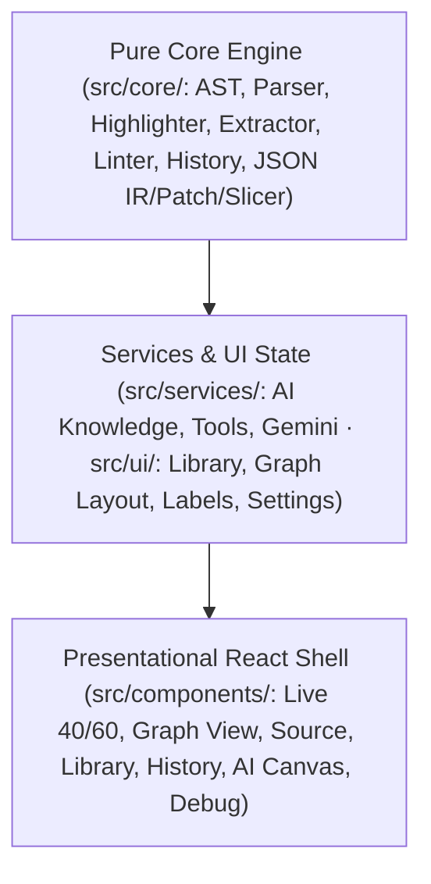

<div align="center">
  
  

  # ScriptFlow

  **Auteur Script Editor & Scene Blueprint**

  *Draft the World. Direct Every Beat.*
</div>

<p align="center">
  <a href="docs/release/v1.1.0.md"></a>
  <a href="docs/GRAMMAR_CONTRACT.md"></a>
  <a href="LICENSE"></a>
  <a href="#available-commands"></a>
  <a href="https://www.typescriptlang.org/"></a>
  <a href="https://react.dev/"></a>
  <a href="https://reactflow.dev/"></a>
</p>

<p align="center">
  <a href="docs/release/v1.1.0.md"><strong>🚀 v1.1.0 Release Notes</strong></a> •
  <a href="docs/GRAMMAR_CONTRACT.md"><strong>📐 Grammar Contract</strong></a> •
  <a href="docs/GRAPH_VIEW.md"><strong>🗺️ Graph View</strong></a> •
  <a href="docs/SCRIPT_SUPERVISOR_AUDIT_RULES.md"><strong>🎬 Audit Rules</strong></a> •
  <a href="docs/JSON_IR_SPEC.md"><strong>🧩 JSON IR Spec</strong></a> •
  <a href="docs/AI_ASSISTANT_WALKTHROUGH.md"><strong>✨ AI Walkthrough</strong></a>
</p>

---

## What is ScriptFlow?

**ScriptFlow** (`v1.1.0`) is a local-first, Plain-Text-as-Truth editor and Scene Blueprint studio for authoring, visualizing, auditing, and exporting **Auteur Script (`v0.4.0`)**—a 100% platform- and model-agnostic canonical inline screenplay grammar designed for spatial, optical, temporal, and acoustic precision.

Live Mode, Graph View, Source Mode, deterministic Script Supervisor diagnostics, exports, and programmatic JSON IR all derive synchronously from a single canonical plain-text buffer—never from a parallel mutable UI document tree.

> **Version Separation Note**
> - **ScriptFlow Application (`v1.1.0`):** Tracks the editor UI, Scene Blueprint Graph View, multi-script library & lineage, version history, and optional browser-local BYOK AI Assistant in `package.json`, [`CHANGELOG.md`](CHANGELOG.md), and [`docs/release/v1.1.0.md`](docs/release/v1.1.0.md).
> - **Auteur Script Specification (`v0.4.0` — Locked):** Tracks the canonical inline syntax, deterministic Script Supervisor linter, and programmatic JSON IR schema (`AUTEUR_IR_SCHEMA_VERSION = "0.4.0"`) separately in [`docs/SPEC_CHANGELOG.md`](docs/SPEC_CHANGELOG.md).

---

## Key Capabilities

1. **Asymmetric `40/60` Live Mode & Source Mode**
   - Independently scrollable **Phase 1 — Staging (`S0`)** and **Phase 2 — Execution (`S1` → `SN`)** columns on desktop (`lg:`) with a draggable split divider (`25%`–`60%`), collapsible cards/Macro-States, and a structured 2-column `[AESTHETIC]` Lookbook editor.
   - Always-formatted `↳` Waterfall Sub-State editing with toggleable 1-based `S#.#` badges, live `->` / `Enter` splitting, `Backspace` merging, `ArrowUp`/`ArrowDown` navigation, `Alt+↑`/`Alt+↓` keyboard Sub-State reordering, hover `+` seams, `@dnd-kit` drag-and-drop reordering, global Paste-and-Hydrate, and active-draft document Undo/Redo (`Cmd/Ctrl+Z`, `Cmd/Ctrl+Shift+Z` / `Ctrl+Y`).
   - Centered single-document **Source Mode** (`~820px` in `JetBrains Mono`) with **Find & Replace** (case, whole-word, Regex with `$1`/`$2` backreferences, phase scope), **Safe Symbol Rename** (characters, `@ref`s, tokens, `[CAM ##]` slots), direct `.txt`/`.md`/`.json` file drop, non-destructive **Format Script**, timestamped/content-hashed exports (`Canonical .txt`, `Tagless .txt`, `JSON Envelope`), and automatic read-only reader mode on narrow `< 640px` viewports.

2. **Read-Only Spatial Graph View (`[ Live | Graph | Source ]`)**
   - Lazy-loaded `@xyflow/react` pan-anywhere blueprint canvas (`>= 640px`, locked cards for smooth desktop & touch panning) visualizing **Phase 1 — Staging (`MB#`)**, an intermediate **Inferred Objects** rail (Characters, `[AESTHETIC]` Tokens + `@ref`, Staging-only Visual Refs, Camera Setups), and **Phase 2 — Execution (`S1 → SN`)** wrapped in **Shot Chambers** with curved **`RECALL`** arcs.
   - Dual-axis **`L → R` / `T ↓ B`** auto-layout (`L → R` starts folded; `T ↓ B` starts unfolded), `[AESTHETIC]` Lookbook key-value expansion (`Keys`/`Fold`), perpendicular Sub-State splitting (`Split`/`Fold`), opposite-side **`Source`** provenance branches, cascading **`Threads`** orthogonal blueprint pipes, a scene-aware **Sub-State Isolator Dock** (`Ghost` vs. `Compact` with gliding pulse-dot animation), a read-only **Object Inspector** with Call Site `fitView` focus, always-ready **`Reset`**, and 4-theme parity. See [`docs/GRAPH_VIEW.md`](docs/GRAPH_VIEW.md).

3. **Deterministic Script Supervisor Linter & 6 Worked Example Families**
   - 5 pure, synchronous linter rules spanning `Lens 1`–`Lens 5` (`viewport-coordinate-purity`, `camera-redefinition-guard`, `macro-state-resolution`, `multimodal-reference-isolation`, `frozen-first-frame-purity`) with persisted per-rule `'off' | 'warning' | 'error'` overrides in Settings and zero-shift `DiagnosticDot` popovers.
   - 6 bundled read-only verbatim JSON example families (10 scripts total, defaulting to *The Grand Continental* alongside *Simit and River Pebbles*, *Cappadocia Balloon Panic*, *Robert's Machu Picchu Trail Dispatch*, and branched `@video1` continuation series *Three Years Late* and *Frequency Over Force*) covering all scene topologies with one-click **Fork to Edit**.

4. **Local-First Script Library, URL Deep-Linking, Import Pre-Flight, Branching & Version History**
   - Browser-local IndexedDB `v3` persistence (`scripts`, `snapshots`, and detached `aiSessions` stores) with `localStorage` fallback & automatic mid-session reconciliation, crash-recovery mirror, debounced + immediate unload flushes, and mutually exclusive URL deep-linking (`/?example=`, `/?url=`, `/?agents=`).
   - Editorial two-pane **Script Library** (`ScriptLibraryModal`) with full-text search, collapsible root-family rows, `Recent ▾` sorting, compact **`Filter ▾`** popover (tab-scoped folder & frequency-sorted `#tag` facets with clickable preview pills), theme-aware folder combobox, opt-in bulk export/delete with lineage repair, and full-library JSON backup.
   - Unified pre-flight **Import / Restore** modal (`ScriptImportModal`) evaluating `v0.4.0` structural fit, lint diagnostics, and `#snapshotHash` duplicates before saving, alongside **Project & Version History** (`VersionHistoryModal`) with automatic pre/post-AI and `Pre-Restore` checkpoints, permanent manual **Milestones**, `branchNote` tracking, and interactive **`Lineage Map`** (`ScriptLineageTree`).

5. **Optional Browser-Local BYOK AI Assistant, Session History & Layer 2.5 Quick Scan**
   - Lazy-loaded right-side AI Canvas Sidebar (`@google/genai` Interactions API streaming across Gemini 4 `Hydrogen` / `Neon` / `Carbon`, `Gemini 3.8 Flash`, and `Gemini 3.5 Flash-Lite`, with `Low` / `Medium` / `High` reasoning, cache-stable 3-Zone prompt prefixing, and `localStorage` or `sessionStorage` BYOK key storage).
   - Unified `Auto` / `Draft` / `Refine` / `Audit` focus bar exposing all 10 strictly read-only/staging browser tools consistently in `Auto`, delta-only turn context & recent-edit diff tracking, On-Demand extension skills (`0.4.0-k5` including `draft_interview`), stepped `1 / N` pause-and-resume clarifying interviews (`Ask First` / `ask_question`), compact collapsible Layer 2.5 **Quick Scan** (`gemini-decision-1` on `v1beta`), detached **AI Session History** (`AiSessionHistoryModal` with `<prior_session_recap>` expired-chain bridging and `.md` / evaluation-ready Full Conversation `.json` / Full Payload `.json` exports), multimodal **Scene Brief & References** modal, 5-tab **Context Inspector** with unified JSON pack Export/Import, Live Mode hover-to-diff margin indicators, USD cost tracking, and opt-in sanitized **Trace Inspector**.

6. **Programmatic JSON IR, Debug Inspector & 4-Mode Themes**
   - Pure TypeScript + Zod `AuteurScriptIR`, `AuteurEnvelope`, transactional `applyAuteurPatch()`, `projectAuteurPatchPreview()`, Composable Lens Slicer (`AUDIT_LENS_PRESETS`), `getAuteurJsonSchemas()`, and zero-cost-when-closed 5-tab `JsonIrDebugDrawer`.
   - 4-mode semantic theme system (**Light** default, **Warm**, **Dark**, **Pure Black** OLED), text-size presets (`13px`–`16px`), toggleable clause underlines and `S#.#` IDs, `ConfirmDialog`, and `ErrorBoundary` crash recovery.

---

## Auteur Script (`v0.4.0`) at a Glance

Every script is plain text partitioned into a strict three-level hierarchy:

1. **Macro-Block (`MB#`)** — Document-level sections separated by blank lines across **Phase 1 — Staging (`S0`)** (`[INTENT]`, `[LOGIC]`, `[AESTHETIC]`, `[OPENING]`, `[CONTINUITY PROTOCOL]`, custom Staging blocks) and **Phase 2 — Execution (`[EXECUTION]`)**.
2. **Macro-State (`S#`)** — A single non-empty line inside `[EXECUTION]` (`S1`, `S2`, …) representing one atomic stretch of screen time.
3. **Sub-State (`S#.#`)** — Each `->`-chained, single-dimension unit inside a Macro-State line, led by a **Sub-State Tag** (`[CAM 01]`, `[ACT]`, `[BLOCK]`, `[LIGHT]`, `[STATE IN]`, `[STATE OUT]`, Tier-2 tags) or inline syntax (`Speaker says (delivery) {line}`, `<foley>`, `(score)`, `【on-screen text】`).

```text
[INTENT]
Create a tense quiet handoff in a dim diner featuring @image1 as Miller (voice: @audio1).

[LOGIC]
Keep the counter as the 180-degree axis with Miller frame-left facing screen-right. No subtitles appear on screen.

[AESTHETIC]
Medium: 35mm film, natural tungsten practicals
Location: late-night chrome diner -> LOC01
Audio: soft refrigerator hum, distant rain on glass

[OPENING]
MS at eye level across the laminate counter in LOC01. Frame-left, Miller sits facing screen-right with a brass key resting flat under his right palm.

[EXECUTION]
[CAM 01] MS across counter -> [ACT] Miller slides the brass key forward with his right hand -> <metal scrape>
[CAM 01] -> Miller says (low, steady) {Check the locker before dawn.} -> [ACT] Miller folds his right hand back onto his lap
```

> 📖 For locked syntax regexes, Tagless export rules, and all 5 linter contracts, see the [**Grammar Contract**](docs/GRAMMAR_CONTRACT.md) and [**Glossary**](docs/GLOSSARY.md).

---

## Editor Shortcuts & Navigation

| Shortcut | Action | Context |
| :--- | :--- | :--- |
| `⌘Z` / `Ctrl+Z` | **Undo** | Document edits (Live & Source modes) |
| `⇧⌘Z` / `Ctrl+Y` | **Redo** | Document edits (Live & Source modes) |
| `->` / `Enter` | **Chain Sub-State** | Focused Sub-State in Live Execution |
| `Alt + ↑` / `↓` | **Move Sub-State** | Reorder focused Sub-State inside its Macro-State |
| `Backspace` | **Merge Sub-State** | At column `0` of an indented `↳` Sub-State |
| `↑` / `↓` | **Navigate** | Sub-State boundaries in Live Mode, or rows in Library / History |
| `Esc` | **Dismiss / Blur** | Close active modal/popover, clear Graph trace, or blur Sub-State |

---

## Quickstart

### Prerequisites
* [Node.js](https://nodejs.org/) (v18+ recommended) and npm

### Installation & Development
```bash
# 1. Clone the repository
git clone https://github.com/taruma/ScriptFlow.git
cd ScriptFlow

# 2. Install dependencies
npm install

# 3. Start local development server
npm run dev
```

Open `http://localhost:3000` in your browser.

### Browser-Local Privacy & BYOK Note

ScriptFlow runs **100% client-side in your browser**—no backend server or proxy is required. All scripts, version snapshots, display preferences, and custom skills stay strictly local in browser IndexedDB and `localStorage`. The AI Assistant is completely optional: if enabled, your BYOK Gemini API key is stored locally in `localStorage` (or tab-scoped `sessionStorage` when **Session only** is enabled) and sent directly from your browser to the Gemini API only when you submit a prompt, run a Quick Scan, or manage Brief Files API attachments.

---

## Available Commands

| Command | Task | Description |
| :--- | :--- | :--- |
| `npm run dev` | **Local Studio** | Starts Vite development server at `http://localhost:3000` |
| `npm test` | **Unit Test Suite** | Runs `371` deterministic tests across `33` files via Vitest |
| `npm run lint` | **Type Check** | Runs strict TypeScript type-checking (`tsc --noEmit`) |
| `npm run build` | **Typecheck & Bundle** | Runs `tsc --noEmit && vite build` to emit `dist/` |
| `npm run preview` | **Preview Build** | Serves the production Vite build locally |

---

## Architecture & Living Documentation Suite

ScriptFlow enforces a strict pure-core boundary: **`src/core/` contains zero React, zero DOM, and zero `localStorage` dependencies**, deriving AST, extracted metadata, diagnostics, highlights, and JSON envelopes synchronously from `rawText`.



### Documentation Sitemap

| Document | Purpose |
|---|---|
| [`docs/release/v1.1.0.md`](docs/release/v1.1.0.md) | **ScriptFlow `v1.1.0`** release notes (AI Session History, Cache-Stable 3-Zone Prompts, Stepped `ask_question`, URL Deep-Linking). |
| [`docs/release/v1.0.0.md`](docs/release/v1.0.0.md) | **ScriptFlow `v1.0.0`** initial release notes, feature overview, and verification summary. |
| [`CHANGELOG.md`](CHANGELOG.md) | Keep-a-Changelog application release history (`v1.1.0`). |
| [`AGENTS.md`](AGENTS.md) | Operational engineering contract, architectural invariants, extension recipes, and Definition of Done. |
| [`docs/SPEC_CHANGELOG.md`](docs/SPEC_CHANGELOG.md) | Version history for the Auteur Script `v0.4.0` grammar, linter, and JSON IR specification. |
| [`docs/GLOSSARY.md`](docs/GLOSSARY.md) | Authoritative Auteur Script vocabulary (`Macro-Block`, `Macro-State`, `Sub-State`, `Sub-State Tag`, inline `[BLOCK]`) mapped to `src/core/types.ts`. |
| [`docs/GRAMMAR_CONTRACT.md`](docs/GRAMMAR_CONTRACT.md) | Locked `v0.4.0` syntax regexes, parser edge cases, Tagless export rules, and deterministic linter contracts. |
| [`docs/SCRIPT_SUPERVISOR_AUDIT_RULES.md`](docs/SCRIPT_SUPERVISOR_AUDIT_RULES.md) | Human-readable checklist of all 4 Scene Topologies, all 5 live linter rules, and all 5 Script Supervisor Audit Lenses (`Lens 1`–`Lens 5`). |
| [`docs/JSON_IR_SPEC.md`](docs/JSON_IR_SPEC.md) | Programmatic `AuteurScriptIR`, `AuteurEnvelope`, transactional `AuteurPatch`, Composable Lens Slicer, and Zod JSON Schema contracts. |
| [`docs/ARCHITECTURE.md`](docs/ARCHITECTURE.md) | Plain-Text-as-Truth data flow, full module map, pure serializer contracts, and global Paste/Undo guards. |
| [`docs/UI_PHILOSOPHY.md`](docs/UI_PHILOSOPHY.md) | Asymmetric `40/60` Live, Source & Graph View layout principles, Waterfall editing, Library/History UX, AI Canvas UX, and 4-mode theme palette. |
| [`docs/GRAPH_VIEW.md`](docs/GRAPH_VIEW.md) | Technical architecture & plain-text extraction reference for the read-only Graph View (`src/ui/canvas/` + `src/components/canvas/`). |
| [`docs/UI_LABELING.md`](docs/UI_LABELING.md) | Single Source of Truth UI copy contract (`APP_META`, `MACRO_BLOCK_META`, `UI_LABELS`), Auteur Script UI vocabulary, and theme labels. |
| [`docs/AI_ASSISTANT_WALKTHROUGH.md`](docs/AI_ASSISTANT_WALKTHROUGH.md) | End-to-end guide to BYOK setup, `Auto`/`Draft`/`Refine`/`Audit` focus, all 10 local AI tools, Quick Scan, Brief modal, Context Inspector, and Trace Inspector. |

---

## Tech Stack

* **Pure Core & Schema Engine**: TypeScript (`7.0`), [Zod](https://zod.dev/) (`v4`)
* **UI & Styling**: [React 19](https://react.dev/), [Tailwind CSS v4](https://tailwindcss.com/), [Lucide React](https://lucide.dev/), [Vite 8](https://vite.dev/)
* **Graph View & Drag-and-Drop**: [React Flow (`@xyflow/react`)](https://reactflow.dev/) (`v13`), [`@dnd-kit`](https://dndkit.com/)
* **Optional AI Runtime (BYOK)**: [`@google/genai`](https://github.com/googleapis/js-genai) (Interactions API, `v1beta` Decisions API, Files API)
* **Local Persistence & Testing**: Browser IndexedDB + `localStorage`, [Vitest](https://vitest.dev/) (`371` tests across `33` files)

---

## Author & Sister Projects

* **Created by**: **Taruma Sakti** ([@taruma](https://github.com/taruma))
* **Sister Suite Projects**:
  * [**SceneFlow**](https://github.com/taruma/screenplay-sync) — Script-to-screen synchronization and adherence review studio.
  * [**StageFlow**](https://github.com/taruma/stageflow) — Interactive 3D camera-blocking diorama & choreography sketchbook.
* **Attribution**: If ScriptFlow inspires your writing, toolmaking, or cinema study, a shout-out or link back to [github.com/taruma/ScriptFlow](https://github.com/taruma/ScriptFlow) is always appreciated!

> [!WARNING]
> **Vibe-Coded Disclaimer**: This software was built through exploratory AI-assisted pair programming and rapid iterations. While backed by 371 unit tests and strict TypeScript checks, always back up important scripts (via `File ▾ → Backup All Scripts`).

---

## License

This project is licensed under the [MIT License](LICENSE).
